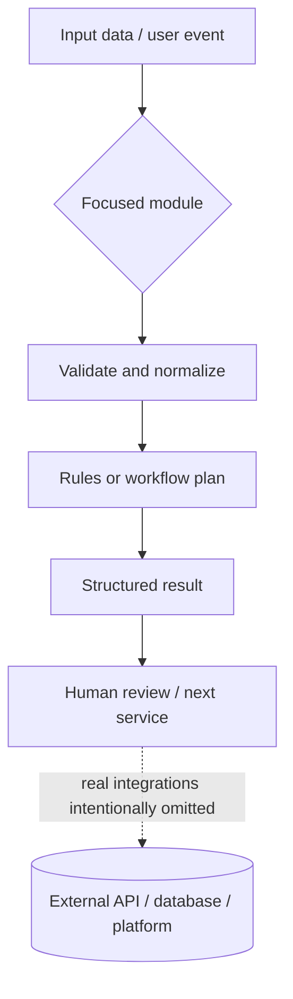

# Python Automation & SaaS — Code Showcase

A small, public-safe portfolio repository demonstrating practical patterns across Python automation, chat-bot decision logic, media workflows, SaaS data models, upload validation, and market-data research.

**Important:** this repository is a set of independently written demonstration examples, inspired by the types of problems addressed in personal projects. It is not a copy of private repositories and does not claim these examples are production deployments. All data is synthetic. No credentials, private customer data, live trading, or real publishing integrations are included.

## What is inside

| Area | Example | Demonstrates | Explicit limitation |
|---|---|---|---|
| Job monitoring | `src/showcase/jobs.py` | Rule-based relevance score, risk phrase rejection, ranked output | Uses supplied sample records; no live scraping |
| Telegram assistant | `src/showcase/chat_policy.py` | Deterministic decision whether a bot should respond | No Telegram connection and no LLM call |
| Video automation | `src/showcase/video_workflow.py` | Ordered workflow plan and safe dry-run representation | No media generation or upload |
| Company directory SaaS | `src/showcase/company_directory.py` | Typed company records and deterministic promotional ranking | Sample data only; not a quality or performance score |
| Real-estate image upload | `src/showcase/photo_upload.py` | File-type and size validation before processing | Does not decode, transform, or enhance images |
| Market-data research | `src/showcase/market_data.py` | Price/volume alert calculation on synthetic observations | Alert-only; no broker connection or orders |

## Quick start

Requires Python 3.10 or newer. No third-party dependencies are required.

Windows PowerShell:
```powershell
$env:PYTHONPATH = "src"
python -m unittest discover -s tests -v
python -m showcase.demo
```

macOS/Linux:
```bash
PYTHONPATH=src python -m unittest discover -s tests -v
PYTHONPATH=src python -m showcase.demo
```

## Architecture at a glance



See [docs/ARCHITECTURE.md](docs/ARCHITECTURE.md) for per-example flow diagrams and file mappings.

## Repository structure

```text
src/showcase/
├── jobs.py                # Rule-based job scoring and risk filtering
├── chat_policy.py         # Chat assistant response decision
├── video_workflow.py      # Dry-run media pipeline planner
├── company_directory.py   # Company records and promotional ranking
├── photo_upload.py        # Upload metadata validation
├── market_data.py         # Synthetic market alert calculation
└── demo.py                # Runnable demonstration

tests/                     # Unit tests for each example
web/company_directory.ts   # Typed filtering and promotional ordering example
sample_data/jobs.json      # Synthetic listings
docs/ARCHITECTURE.md       # Technical flow diagrams and limitations
docs/PORTFOLIO_GUIDE.md    # Suggested truthful Upwork portfolio presentation
```

## Security and engineering choices

- No API keys or `.env` files are required.
- The examples do not scrape external sites or send data to Telegram, YouTube, any LLM provider, or a broker.
- The market module produces alerts only; it contains no order-execution code.
- Upload validation checks declared MIME type and size only. Production systems should inspect file signatures, decode images safely, enforce authorization, and consider malware scanning.
- Rule-based scores are explainable heuristics, not an AI model or a guarantee of job quality.

## Status

This is a small, independently written learning/demo showcase. It is intentionally smaller than a commercial product and makes its limitations explicit. Do not describe these examples as production-ready.
