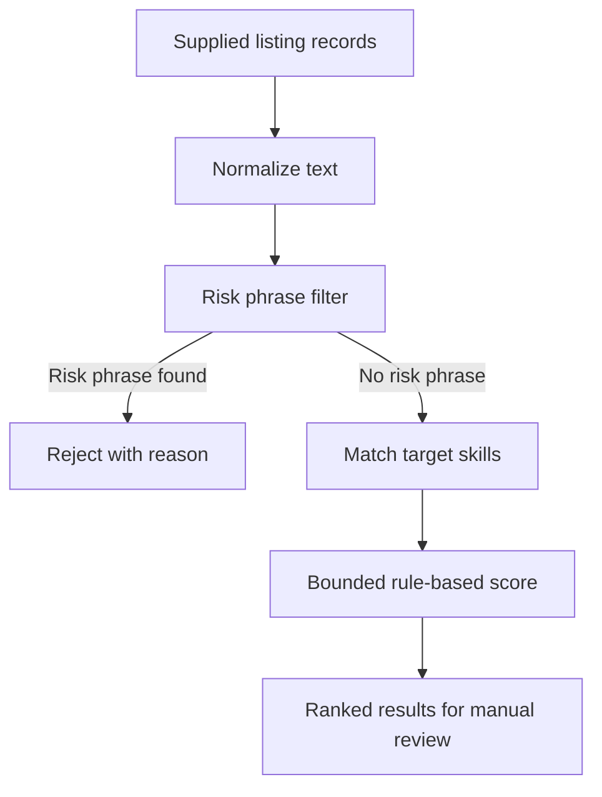
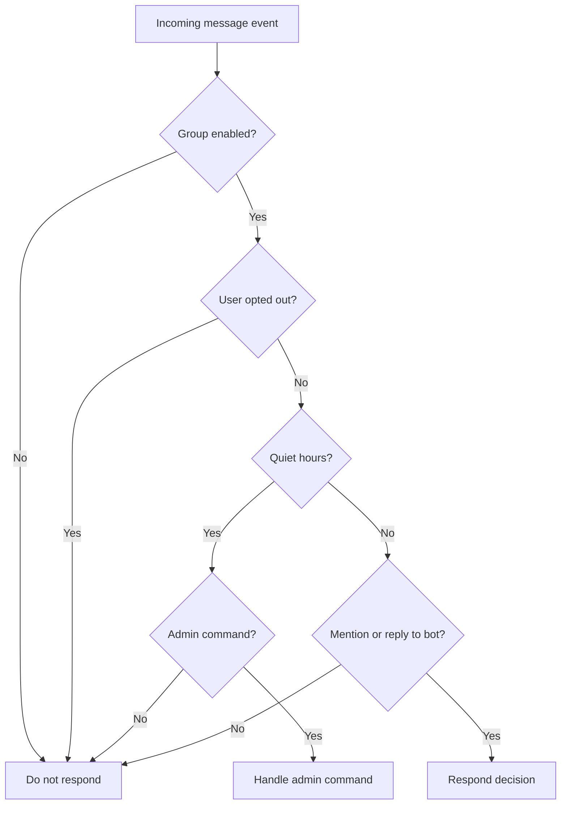
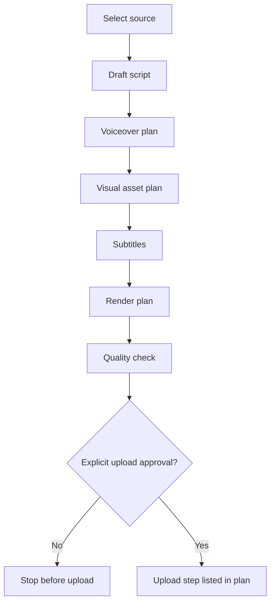
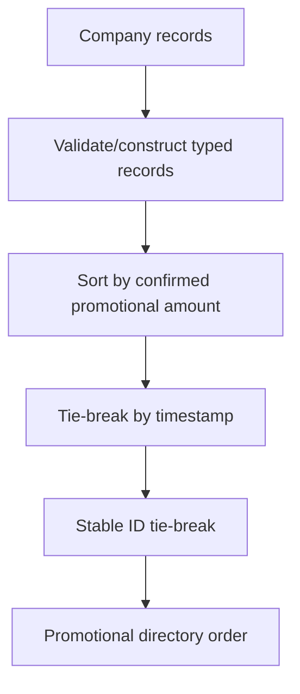
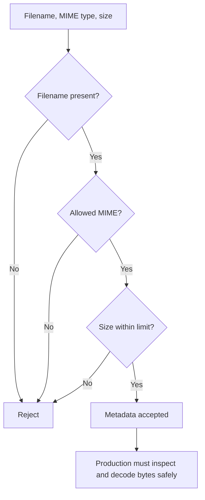
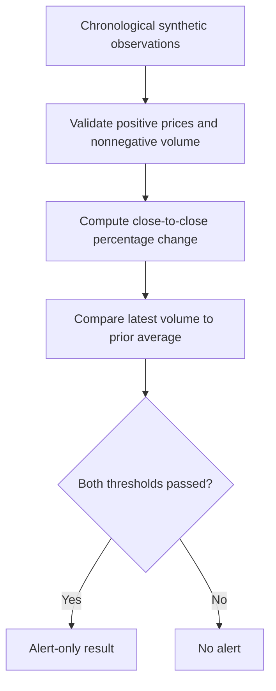

# Architecture notes

These diagrams describe the demonstration modules in this repository, not the full architecture of any private project.

## 1. Job monitoring

Files: `src/showcase/jobs.py`, `tests/test_jobs.py`.

## 2. Group assistant decision

File: `src/showcase/chat_policy.py`. The module does not send Telegram messages.

## 3. Video pipeline planner

File: `src/showcase/video_workflow.py`. The output is only a plan; neither rendering nor uploading is performed.

## 4. Company directory

File: `src/showcase/company_directory.py`. The demo ranking represents promotional support only, not a quality assessment.

## 5. Image upload validation

File: `src/showcase/photo_upload.py`. Metadata validation alone does not establish that a file is a safe image.

## 6. Market-data alert

File: `src/showcase/market_data.py`. No broker adapter or order-execution function exists in this showcase.
